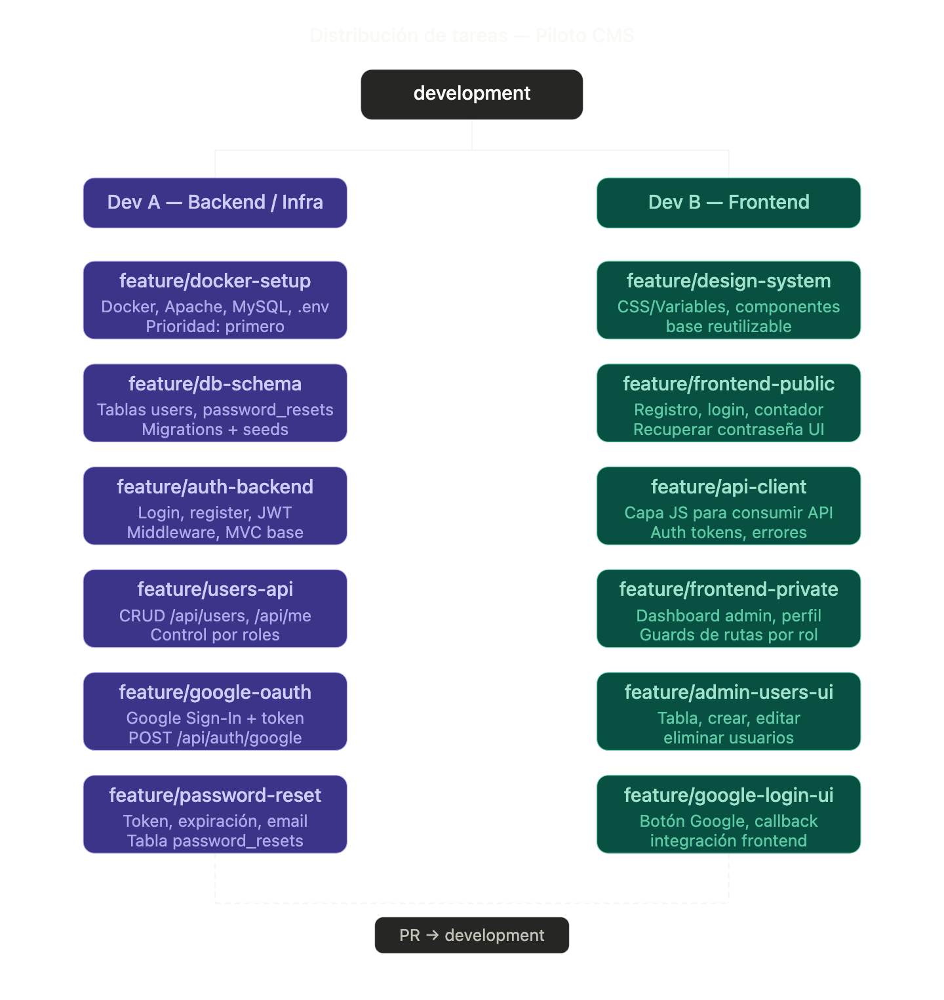

# Planificación del Piloto CMS

## Orden de trabajo y dependencias

El único bloqueo real es que Dev B necesita la API funcionando para conectar el frontend. La solución es acordar el **contrato de la API** (rutas, formato de respuesta, errores) antes de empezar, y que Dev B trabaje contra **datos mock** hasta que el backend esté listo.

````
Significa que Dev B no puede conectar el frontend a la API si la API no existe todavía. Pero tampoco tiene sentido que se quede parado esperando a Dev A.

La solución tiene dos partes.

**Acordar el contrato antes de empezar** significa que los dos se sientan y deciden exactamente cómo va a funcionar la API antes de escribir ni una línea de código. Por ejemplo, acuerdan que el login va a devolver siempre esto:

```json
{
  "user": {
    "id": 1,
    "nombre": "Ana García",
    "email": "ana@ejemplo.com",
    "rol": "admin"
  },
  "token": "abc123xyz..."
}
```

Y que si el login falla, devolverá esto:

```json
{
  "message": "Credenciales incorrectas"
}
```

Con eso acordado, Dev B ya sabe exactamente qué va a recibir aunque la API no exista todavía.

**Trabajar contra mocks** significa que Dev B crea un fichero JSON falso en local que simula las respuestas de la API. El frontend llama a ese fichero en lugar de a la API real. Así puede construir toda la interfaz, los formularios, la navegación y la lógica de errores como si la API ya estuviera funcionando.

Cuando Dev A termina el backend real, Dev B solo tiene que cambiar una línea: la URL a la que apunta el api-client. Todo lo demás ya está hecho y funciona igual porque las respuestas tienen exactamente el formato que acordaron al principio.
````

````
La API es el backend, concretamente el conjunto de endpoints que Dev A construye en PHP.

Cuando Dev B dice "necesito la API", está diciendo "necesito que el servidor esté funcionando y respondiendo a mis peticiones". Sin eso, el frontend puede tener los formularios perfectamente diseñados pero al pulsar "Entrar" no tiene a dónde enviar los datos.

En este proyecto la API es todo lo que vive en la carpeta `backend/` y que responde en `http://localhost:8080`. Cuando el frontend hace esto:

```javascript
PilotoApi.post('/api/auth/login', { email, password })
```

Está llamando a la API. Si la API no está levantada, esa llamada falla y no pasa nada.

La separación es clara: Dev A construye la API (el backend en PHP que procesa datos y habla con la base de datos) y Dev B construye la interfaz (los HTMLs que el usuario ve y que usan esa API para funcionar). Son dos piezas distintas que se comunican entre sí, y por eso Dev B depende de que Dev A termine su parte.
````

**Semana 1 — en paralelo desde el día 1:**

Dev A empieza por `docker-setup` y `db-schema`, que son la base de todo. Una vez levantado el entorno, Dev B puede clonarlo y arrancar. Mientras Dev A construye `auth-backend`, Dev B monta el `design-system` y el `api-client` con datos mock.

**Semana 2:**

Dev A saca `users-api` y Dev B conecta el `frontend-public` a la API real. A partir de aquí los PRs se van entrelazando: cada vez que Dev A mergea un endpoint, Dev B conecta la UI correspondiente.

**`google-oauth` y `password-reset`** son las últimas tareas de ambos, ya que dependen de que el flujo base esté consolidado.

------

## Convención de ramas y PRs

```bash
# Crear rama desde development
git checkout development
git pull origin development
git checkout -b feature/auth-backend

# Al terminar, abrir PR a development
# — El compañero revisa el código
# — Se mergea solo si pasa la revisión
```

Para los PRs os recomiendo acordar al menos una regla: no se mergea sin al menos un comentario de revisión del otro, aunque sea "LGTM". Así el historial queda limpio y ambos conocéis todo el código.

¿Quieres que profundice en alguna tarea concreta, que defina el contrato de la API en detalle, o que proponga la estructura de carpetas del proyecto?


## El punto crítico de todo el proyecto

`feature/auth-backend` (Fase 2, Dev A) es el mayor cuello de botella porque es la base de todo lo que viene después: los tres endpoints de backend de Fase 3 dependen de él, y Dev B no puede cerrar el frontend-public real hasta que esté mergeado.

La estrategia para no perder tiempo: Dev B construye el frontend-public completo contra mocks JSON locales (un fichero con respuestas simuladas de login, register, etc.) y cuando Dev A mergea `auth-backend`, Dev B solo tiene que cambiar la URL base del api-client. El código de UI no cambia nada.

## Regla de oro para los PRs

Dado el árbol de dependencias, os propongo esta convención para los mensajes de PR:

```
feat(docker-setup): entorno LAMP dockerizado

Desbloquea: feature/db-schema (Dev A)
            Dev B puede clonar y arrancar
```

Así cualquiera de los dos ve de un vistazo qué se puede retomar cuando llega una notificación de merge. ¿Quieres que entremos en el detalle de alguna fase concreta o empezamos a definir la estructura de carpetas del proyecto?

Vamos a estructurar el proyecto en tareas independientes, con una rama por tarea y PR a `development`. La clave es definir bien las **dependencias** para que podáis trabajar en paralelo desde el primer día.

## Estructura de ramas

```
main
└── development
    ├── feature/docker-setup
    ├── feature/db-schema
    ├── feature/auth-backend
    ├── feature/users-api
    ├── feature/stats-api
    ├── feature/frontend-public
    ├── feature/frontend-private
    └── feature/google-oauth
```

------

## Reparto de tareas

Divido en dos perfiles naturales: **Backend** y **Frontend**.



---

## Distribución de tareas por perfil

### Dev A — Backend/Infra

- `feature/docker-setup` — Docker, Apache, MySQL, .env. Prioridad: primero.
- `feature/db-schema` — Tablas users y password_resets. Migrations + seeds.
- `feature/auth-backend` — Login, register, JWT. Middleware y base MVC.
- `feature/users-api` — CRUD /api/users y /api/me. Control por roles.
- `feature/google-oauth` — Google Sign-In + token. POST /api/auth/google.
- `feature/password-reset` — Token, expiración, email. Tabla password_resets.

### Dev B — Frontend

- `feature/design-system` — CSS/variables, componentes, base reutilizable.
- `feature/api-client` — Capa JS para consumir API. Auth tokens y errores.
- `feature/frontend-public` — Registro, login, contador, recuperar contraseña UI.
- `feature/frontend-private` — Dashboard admin, perfil. Guards de rutas por rol.
- `feature/admin-users-ui` — Tabla, crear, editar y eliminar usuarios.
- `feature/google-login-ui` — Botón Google, callback, integración frontend.

Todas las ramas salen de `development`. Cada una se cierra con un PR revisado por Víctor antes de mergear.

------

## Fases de trabajo detalladas

------

### Fase 0

**Sincronización de fase:** Antes de empezar, acordar el contrato de la API: rutas, JSON de respuesta, formato de errores y estructura de tokens JWT. Dev B trabajará contra mocks hasta que los endpoints reales estén disponibles.

**Dev A — `feature/docker-setup`** (sin dependencias previas)

Entrega:

- docker-compose.yml
- Apache + PHP
- MySQL + init.sql
- .env.example
- README de arranque

Desbloquea: `feature/db-schema` y que Dev B pueda clonar el entorno.

------

**Dev B — `feature/design-system`** (sin dependencias previas)

Entrega:

- Variables CSS (colores, tipografía)
- Componente botón, input, card
- Layout público y privado base
- Estilos de formularios

Desbloquea: `feature/api-client` y `feature/frontend-public`.

------

### Fase 1

**Sincronización de fase:** Al mergear docker-setup y design-system, Dev A puede arrancar db-schema sobre el entorno real. Dev B clona el entorno y monta el api-client contra mocks JSON locales. Ambos ya tienen trabajo sin bloquearse.

**Dev A — `feature/db-schema`**

Necesita: docker-setup mergeado.

Entrega:

- Tabla users (id, nombre, email, password, google_id, rol, created_at)
- Tabla password_resets (email, token, expires_at)
- Script de migración
- Seeds de prueba (admin + user estándar)

Desbloquea: `feature/auth-backend`.

------

**Dev B — `feature/api-client`**

Necesita: design-system mergeado. Trabaja con mocks JSON locales.

Entrega:

- Módulo JS fetch wrapper
- Gestión de JWT (guardar, cabeceras, expirar)
- Manejo de errores HTTP
- Funciones: login(), register(), getMe(), getUsers()

Desbloquea: `feature/frontend-public` y `feature/frontend-private`.

------

### Fase 2

**Sincronización de fase:** Al mergear db-schema, Dev A empieza auth-backend, que es el bloqueo principal del proyecto. Dev B conecta el frontend-public al api-client y trabaja el flujo visual completo contra mocks, sin esperar endpoints reales.

**Dev A — `feature/auth-backend`**

Necesita: db-schema mergeado.

Entrega:

- Estructura MVC (Router, Controller, Service, Repository)
- POST /api/auth/register
- POST /api/auth/login
- GET /api/me
- Middleware de autenticación y roles
- Generación y validación de JWT

Desbloquea: `feature/users-api`, `feature/password-reset`, `feature/google-oauth`.

------

**Dev B — `feature/frontend-public`**

Necesita: api-client mergeado. Login y registro trabajan contra mocks hasta que auth-backend esté listo.

Entrega:

- Página de registro con validación en cliente
- Página de login
- Formulario de recuperar contraseña
- Contador de usuarios registrados (GET /api/stats/users-count)
- Ruta de callback OAuth

Desbloquea: `feature/frontend-private` y `feature/google-login-ui`.

------

### Fase 3

**Sincronización de fase:** Al mergear auth-backend, Dev B conecta frontend-public a los endpoints reales y cierra los mocks. Dev A abre tres ramas en paralelo (users-api, password-reset, google-oauth) porque todas dependen únicamente de auth-backend.

**Dev A — `feature/users-api`**

Necesita: auth-backend mergeado.

Entrega:

- GET /api/users (solo admin)
- POST /api/users (solo admin)
- PUT /api/users/:id (solo admin)
- DELETE /api/users/:id (solo admin)
- PUT /api/me/password
- GET /api/stats/users-count

Desbloquea: `feature/admin-users-ui` y que Dev B conecte el frontend-private a datos reales.

------

**Dev A — `feature/password-reset`**

Necesita: auth-backend mergeado.

Entrega:

- POST /api/auth/forgot-password (genera token)
- POST /api/auth/reset-password (valida y cambia contraseña)
- Gestión de expiración de token
- Envío de email configurable

Desbloquea: que el frontend-public conecte el flujo real de recuperación.

------

**Dev A — `feature/google-oauth`**

Necesita: auth-backend mergeado.

Entrega:

- POST /api/auth/google
- Verificación de token Google ID
- Upsert de usuario con google_id
- Devolución de JWT propio

Desbloquea: `feature/google-login-ui`.

------

**Dev B — `feature/frontend-private`**

Necesita: frontend-public mergeado y api-client mergeado. El dashboard admin trabaja con mocks hasta que users-api esté disponible.

Entrega:

- Guard de autenticación (redirige si no hay JWT)
- Guard de rol (admin vs user)
- Vista perfil de usuario (ver + cambiar contraseña)
- Dashboard admin (estructura y stats)

Desbloquea: `feature/admin-users-ui`.

------

### Fase 4

**Sincronización de fase:** Con users-api y google-oauth mergeados, Dev B cierra los dos bloques pendientes: conecta el panel admin a la API real y conecta el botón de Google. Dev A puede hacer revisión cruzada del código frontend y preparar la demo.

**Dev A — revisión + demo**

Necesita: todas las ramas backend mergeadas.

Entrega:

- Code review de los PRs de frontend
- Tests de integración de la API
- Datos de demo (usuarios de prueba)
- Documentación de endpoints

Desbloquea: la entrega del piloto.

------

**Dev B — `feature/admin-users-ui`**

Necesita: frontend-private mergeado y users-api mergeado.

Entrega:

- Tabla de usuarios paginada
- Modal para crear usuario
- Modal para editar usuario
- Confirmación de eliminación
- Actualización del contador en tiempo real

Desbloquea: la demo de admin completa.

------

**Dev B — `feature/google-login-ui`**

Necesita: frontend-public mergeado y google-oauth mergeado.

Entrega:

- Botón "Continuar con Google"
- Flujo OAuth en popup o redirect
- Gestión de callback y JWT
- Manejo de error cuando la cuenta no está registrada

Desbloquea: la demo de login con Google completa.

------

## El punto crítico del proyecto

`feature/auth-backend` (Fase 2, Dev A) es el mayor cuello de botella porque es la base de todo lo que viene después. Los tres endpoints de backend de Fase 3 dependen de él, y Dev B no puede cerrar el frontend-public real hasta que esté mergeado.

La estrategia para no perder tiempo: Dev B construye el frontend-public completo contra mocks JSON locales (un fichero con respuestas simuladas de login, register, etc.) y cuando Dev A mergea auth-backend, Dev B solo tiene que cambiar la URL base del api-client. El código de UI no cambia nada.

------

## Estructura de ramas

```
main
└── development
    ├── feature/docker-setup        (Dev A — Fase 0)
    ├── feature/db-schema           (Dev A — Fase 1)
    ├── feature/auth-backend        (Dev A — Fase 2)
    ├── feature/users-api           (Dev A — Fase 3)
    ├── feature/password-reset      (Dev A — Fase 3)
    ├── feature/google-oauth        (Dev A — Fase 3)
    ├── feature/design-system       (Dev B — Fase 0)
    ├── feature/api-client          (Dev B — Fase 1)
    ├── feature/frontend-public     (Dev B — Fase 2)
    ├── feature/frontend-private    (Dev B — Fase 3)
    ├── feature/admin-users-ui      (Dev B — Fase 4)
    └── feature/google-login-ui     (Dev B — Fase 4)
```

------

## Convención de ramas y PRs

```bash
# Crear rama desde development
git checkout development
git pull origin development
git checkout -b feature/auth-backend

# Al terminar, abrir PR a development
# El compañero revisa antes de mergear
```

Mensaje de PR recomendado:

```
feat(docker-setup): entorno LAMP dockerizado

Desbloquea: feature/db-schema (Dev A)
            Dev B puede clonar y arrancar
```

Así cualquiera de los dos ve de un vistazo qué se puede retomar cuando llega la notificación de merge.

------

## Regla de equipo

No se mergea ningún PR sin al menos un comentario de revisión del compañero, aunque sea un simple "LGTM". Esto mantiene el historial limpio y garantiza que los dos conocen todo el código del proyecto.