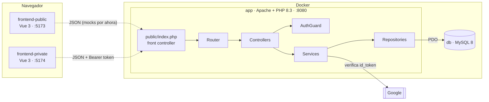
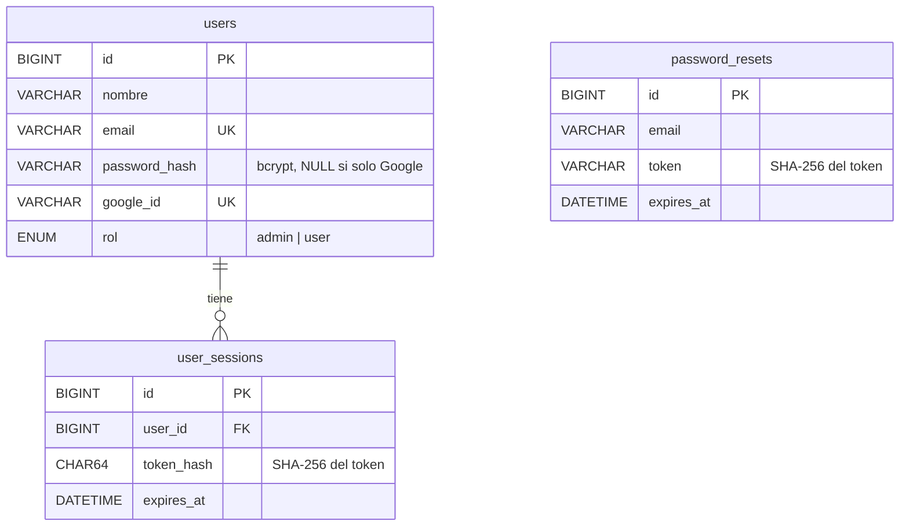

# Piloto CMS

Sistema de gestión de usuarios con control de acceso, pensado como base de un futuro CMS. **API REST en PHP 8.3 sin framework** (arquitectura en capas, autenticación por token, roles admin/user, login con Google y recuperación de contraseña), **MySQL** y **Docker**, con dos SPAs en **Vue 3 + Vite**: una zona pública y una zona privada.

> **Estado:** el backend está completo. Los dos frontends tienen la interfaz completa y funcionan contra datos simulados (*mocks*) que respetan el contrato de la API; conectarlos es el siguiente paso (ver *Próximos pasos* al final).

---

## Funcionalidades

**Zona pública** (sin login): registro, inicio de sesión, login con Google, recuperación de contraseña y contador de usuarios registrados.

**Zona privada** (con login), según el rol:

- **Administrador:** dashboard, gestión de usuarios (crear, editar, eliminar) y métricas.
- **Usuario:** perfil y cambio de contraseña.

---

## Arquitectura



- **Backend en capas, sin framework:** `Router` propio con rutas dinámicas, `Controllers` (HTTP), `Services` (reglas de negocio), `Repositories` (SQL con PDO y *prepared statements*) y un middleware `AuthGuard` para autenticación y roles. Inyección de dependencias manual en `public/index.php`.
- **Frontends desacoplados:** dos SPAs independientes con Vue Router y *composables*; la privada protege sus rutas con guards de token y rol (solo experiencia de usuario: la seguridad real está en la API).

### Stack y por qué

| Pieza | Elección | Motivo |
|---|---|---|
| Backend | PHP 8.3 sin framework | Requisito del proyecto: implementar a mano router, middleware y capas para entenderlas |
| Base de datos | MySQL 8 + PDO | Estándar LAMP; consultas preparadas sin dependencias |
| Infraestructura | Docker Compose | Entorno reproducible con un comando |
| Frontend | Vue 3 + Vite + Vue Router | Migrado desde JS vanilla: reactividad, componentes y routing para una app que crecerá |

---

## Puesta en marcha

Requisitos: Docker y Node.js 18 o superior.

### 1. Backend (API + MySQL)

```bash
cp .env.example .env          # y cambia las contraseñas
docker compose up --build
```

La API queda en `http://localhost:8080`. Comprobación: `curl http://localhost:8080/api/health` → `{"status":"ok",...}`

> MySQL crea la base de datos y el usuario solo la primera vez, con los valores del `.env`. Si cambias las credenciales después, recrea el volumen: `docker compose down -v`.

### 2. Frontend público

```bash
cd frontend-public
npm install
npm run dev                   # http://localhost:5173
```

### 3. Frontend privado

```bash
cd frontend-private
cp .env.example .env
npm install
npm run dev                   # http://localhost:5174
```

Mientras los frontends usan mocks, para entrar en la zona privada abre `http://localhost:5174/dev-login` y elige admin o usuario. Esa ruta solo existe con `VITE_APP_ENV=development`.

### Credenciales de prueba (API)

```
Email:      admin@piloto.local
Contraseña: PilotoAdmin1!
```

### Probar la API sin frontend

```bash
# Login → devuelve { user, token }
curl -X POST http://localhost:8080/api/auth/login \
     -H "Content-Type: application/json" \
     -d '{"email":"admin@piloto.local","password":"PilotoAdmin1!"}'

# Endpoint protegido con el token obtenido
curl http://localhost:8080/api/users -H "Authorization: Bearer <token>"
```

---

## API

Todas las respuestas son JSON. Los errores siguen el formato `{"message": "..."}` con el código HTTP adecuado.

| Método | Ruta | Acceso | Descripción |
|---|---|---|---|
| GET | `/api/health` | Público | Estado de la API |
| GET | `/api/stats/users-count` | Público | Total de usuarios |
| POST | `/api/auth/register` | Público | Registro (devuelve usuario + token) |
| POST | `/api/auth/login` | Público | Login (devuelve usuario + token) |
| POST | `/api/auth/google` | Público | Login con un `id_token` de Google |
| POST | `/api/auth/forgot-password` | Público | Solicita recuperación de contraseña |
| POST | `/api/auth/reset-password` | Público | Completa la recuperación con el token |
| GET | `/api/me` | Usuario | Datos del usuario en sesión |
| PUT | `/api/me/password` | Usuario | Cambiar la contraseña propia |
| GET | `/api/users` | Admin | Listar usuarios |
| POST | `/api/users` | Admin | Crear usuario |
| PUT | `/api/users/{id}` | Admin | Editar usuario |
| DELETE | `/api/users/{id}` | Admin | Eliminar usuario |

Los endpoints protegidos requieren la cabecera `Authorization: Bearer <token>`.

---

## Modelo de datos



---

## Seguridad

- **Contraseñas** con bcrypt (`password_hash` / `password_verify`).
- **Tokens de sesión opacos:** 32 bytes aleatorios; al cliente se envía el token y en la base de datos solo se guarda su hash SHA-256. Caducan a los 7 días y se revocan al cambiar la contraseña o el rol.
- **Roles verificados en el servidor** en cada petición (401 sin sesión válida, 403 sin permiso).
- **Recuperación de contraseña:** token aleatorio hasheado, caducidad de 60 minutos, un solo uso y respuesta idéntica exista o no el email (evita la enumeración de usuarios).
- **Google:** se verifican audiencia, emisor, caducidad y email verificado del `id_token` antes de emitir un token propio.
- **SQL** siempre con consultas preparadas.
- **Integridad:** no se puede eliminar ni degradar al último administrador.

---

## Decisiones técnicas

Las más relevantes (el registro completo, con su razonamiento, está en [docs/DECISIONES.md](docs/DECISIONES.md)):

- **Tokens opacos en base de datos en lugar de JWT:** permiten revocar sesiones al instante, a cambio de una consulta por petición, asumible en un monolito con una sola base de datos.
- **Desarrollo *contract-first* con mocks:** se acordó el formato de la API y el frontend se construyó contra respuestas simuladas para avanzar en paralelo con el backend.
- **Migración incremental de JS vanilla a Vue 3:** en una rama propia, una vista por commit y sin romper el funcionamiento en ningún paso; integrada mediante pull request. La versión vanilla se conserva en la rama `vanilla`.

---

## Estructura del repositorio

```
piloto-cms/
├── backend/
│   ├── public/            index.php (front controller) y .htaccess
│   ├── config/            bootstrap.php (autoloader)
│   └── src/               Core · Controllers · Services · Repositories · Middleware
├── frontend-public/       SPA pública (Vue 3 + Vite)
├── frontend-private/      SPA privada (Vue 3 + Vite)
├── design-system/         Tokens y componentes CSS de la primera versión
├── docker/apache/         Dockerfile y vhost
├── sql/                   init.sql y migraciones
├── docs/                  Decisiones técnicas y diario de desarrollo
└── docker-compose.yml
```

## Ramas

- `main`: versión estable.
- `development`: integración; las ramas `feature/*` y `fix/*` entran por pull request.
- `vanilla`: referencia congelada del frontend en JavaScript sin framework (no se fusiona).

---

## Próximos pasos

- [ ] Conectar los frontends a la API (sustituir los mocks por `fetch` con un cliente común).
- [ ] Tests de la lógica principal (autenticación, middleware, reglas de administradores) e integración continua.
- [ ] Endpoint de logout que invalide el token en el servidor.
- [ ] Límite de intentos de login.
- [ ] Manejador global de errores para responder siempre en JSON.
- [ ] Envío real del email de recuperación de contraseña.
- [ ] Verificación local del `id_token` de Google con sus claves públicas (JWKS).

---

## Desarrollo asistido por IA

El proyecto se desarrolló con asistencia de IA (Cursor) como par de programación: la planificación, la arquitectura, la revisión del código y las decisiones son propias, y cada sesión quedó documentada en [docs/DIARIO.md](docs/DIARIO.md).
